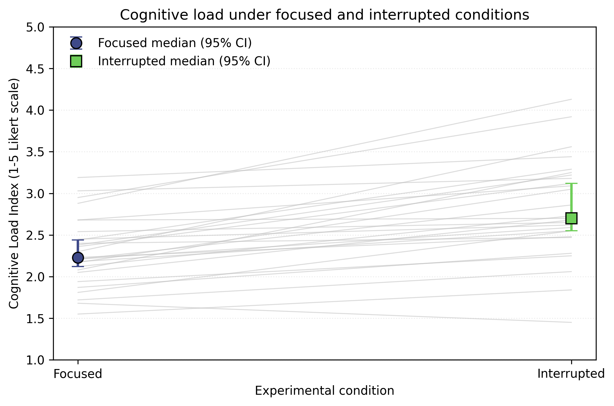
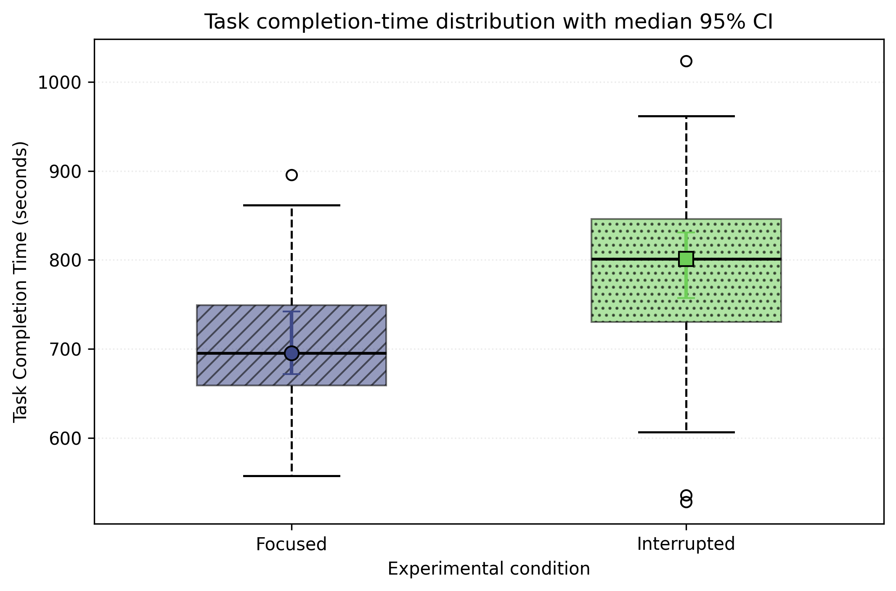

# Procrastination Triggers in the Digital Environment

## How Context Switching and Micro-Habits Affect the Concentration of IT Students

**Authors:** Mashat Bekzhan, Nursultan Sultan  
**Course:** Research Methods  
**Group:** SCOM3001-ENG-9  
**University:** Narxoz University  
**Status:** Task 3 - reproducible analysis and scientific visualization  
**License:** MIT (code)

> **Data transparency:** The bundled `data/raw/test_run.jsonl` is a synthetic pilot dataset used to validate the Task 3 pipeline. It is not empirical participant data and must not be reported as real findings about students.

## Project Overview

This quantitative research studies how digital distractions and context switching are related to cognitive load, concentration, and academic procrastination among IT students.

Task 3 focuses on the controlled RQ2 comparison between:
- **Focused baseline:** notifications disabled and no unrelated switching.
- **Interrupted condition:** comparable technical task with standardized interruption signals.

The analysis pipeline filters warm-up rows, tracks task-error rate as a guardrail, calculates robust descriptive statistics and bootstrapped confidence intervals, and exports publication-ready figures.

## Research Questions

**RQ1.** Which disruptive digital habits are most common among IT students during academic and practical tasks?

**RQ2.** How do frequent context switching and multitasking affect perceived cognitive load and mental fatigue while students write code or solve algorithmic problems?

**RQ3.** How is cognitive overload caused by digital distractions related to the transition from academic work to academic procrastination?

### Controlled-comparison hypothesis

- **H0:** Perceived cognitive load does not significantly differ between focused and interrupted conditions.
- **H1:** Perceived cognitive load is higher in the interrupted condition than in the focused condition.

Primary metric:

`Delta CLI = CLI(interrupted) - CLI(focused)`

## Repository Structure

```text
procrastination-it-students/
├── configs/
│   └── task3_analysis_config.json
├── data/
│   ├── raw/
│   │   ├── README.md
│   │   └── test_run.jsonl
│   └── processed/
│       └── metrics_summary.csv
├── docs/
│   └── domain_model.md
├── notebooks/
│   └── 01_data_analysis.ipynb
├── reports/
│   ├── task3_report.md
│   └── figures/
│       ├── fig1_cognitive_load_comparison.pdf
│       ├── fig1_cognitive_load_comparison.png
│       ├── fig2_completion_time_boxplot.pdf
│       └── fig2_completion_time_boxplot.png
├── results/
│   └── task3_statistics.json
├── src/
│   ├── process_data.py
│   └── visualize.py
├── .gitignore
├── requirements.txt
└── README.md
```

Existing Task 1 / Task 2 documentation can remain in the same repository.

## System Requirements

- Python 3.11 or 3.12
- Windows 10/11, macOS, or Linux
- No GPU required

## Quickstart

From the repository root:

```bash
python -m pip install -r requirements.txt
python src/process_data.py
python src/visualize.py
```

Then open:

```text
notebooks/01_data_analysis.ipynb
```

and use **Restart Kernel and Run All**.

## Data Processing & Statistical Rules

1. Raw records are read from `data/raw/test_run.jsonl`.
2. Rows with `phase = warmup` are removed before evaluation statistics.
3. Task-error rows remain in the dataset for guardrail reporting but are excluded from the primary metric comparison.
4. For each condition, the pipeline reports:
   - Mean and SD
   - Median
   - p25 and p75
   - p95 and p99
   - Bootstrapped 95% CI around the median
5. The paired CLI comparison uses participants with valid measurements in both conditions.
6. Random seed is fixed at **42**.
7. Statistical alpha is **0.05**.

## Results & Discussion

### Synthetic pilot benchmark table

| Metric | Focused baseline | Interrupted condition |
|---|---:|---:|
| Cognitive Load Index (1-5), Median (p25-p75) | 2.23 (2.05-2.45) | 2.71 (2.53-3.19) |
| Completion Time (s), Median (p25-p75) | 695.2 (659.1-749.3) | 801.0 (730.3-846.1) |
| Accuracy (%), Median (p25-p75) | 88.0 (85.5-92.5) | 87.7 (78.9-93.5) |
| Context Switches (count), Median (p25-p75) | 1.0 (0.0-2.0) | 6.0 (3.8-7.0) |
| Task Error Rate (%) | 3.3 | 6.7 |


The synthetic pilot produced **27 complete pairs** after guardrail filtering.  
Mean Delta CLI was **0.52** with a bootstrapped 95% CI of **[0.37, 0.66]**.

The normality check on paired CLI differences produced Shapiro-Wilk `p = 0.442`. The pipeline therefore selected **paired t test** for the bundled pilot dataset.

**Interpretation boundary:** these values demonstrate the analysis procedure only. They do not support empirical claims about the real student population until the synthetic file is replaced with actual anonymized Week 7-8 observations.

## Scientific Figures

### Figure 1 - Cognitive Load Index with 95% CI



The y-axis explicitly reports the CLI scale (1-5). Individual paired observations are shown with the group median and bootstrapped 95% CI.

### Figure 2 - Completion-Time Distribution with 95% CI



The y-axis reports seconds. Boxplots show dispersion, while overlaid markers show the median and bootstrapped 95% CI. Distinct hatching and markers improve monochrome readability.

Both plots are exported as:
- vector `.pdf`;
- raster `.png` at 300 DPI.

## Domain Model

The Task 3 domain artifact is available at:

[`docs/domain_model.md`](docs/domain_model.md)

It models the controlled-task data path from participant session to metric collection, raw JSONL, processing, notebook analysis, figures, and reporting.

## Reproducibility

The notebook is designed to be executed sequentially from top to bottom. It contains:
- explanatory Markdown;
- fixed random seed;
- raw-data ingestion;
- warm-up filtering;
- statistical aggregation;
- guardrail error-rate reporting;
- paired comparison;
- visible figure outputs.

## Real Data Privacy

For real data:
- use anonymous participant codes such as `P01`;
- do not store names or student IDs in GitHub;
- do not commit private messages, credentials, or identifiable raw records;
- keep any identifiable mapping outside the public repository.

## Task 3 Release Tag

After the final commit and after replacing pilot data if real observations are available:

```bash
git tag -a v0.3-task3 -m "Task 3 research results and visualization"
git push origin v0.3-task3
```

## Citation

```bibtex
@misc{mashat_sultan_2026_procrastination,
  author      = {Mashat, Bekzhan and Sultan, Nursultan},
  title       = {Procrastination Triggers in the Digital Environment:
                  How Context Switching and Micro-Habits Affect the Concentration of IT Students},
  year        = {2026},
  institution = {Narxoz University},
  note        = {Research Methods student project}
}
```

## License

Source code is released under the MIT License. Participant-level research data are not covered by the software license.
