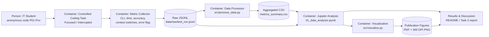

# Domain Model - Task 3

## Track
**Software Engineering / research-pipeline track**

The artifact below models the controlled-task measurement pipeline as a set of software containers.  
Metric collection points are shown explicitly because Task 3 requires the domain model to identify where measurements enter the system.

## Container responsibilities

| Component | Responsibility | Main inputs | Main outputs / metrics |
|---|---|---|---|
| Controlled Coding Task | Runs the two comparable conditions | Task instructions, condition order | Observable task performance |
| Metric Collector | Records standardized task measurements | Participant task session | CLI (1-5), completion time (s), accuracy (%), context switches (count), task error |
| Raw Data Store | Preserves machine-readable run records | JSON records | `test_run.jsonl` |
| Data Processor | Filters warm-up rows, applies guardrail filtering, aggregates statistics | Raw JSONL | Median, p25/p75, p95, p99, bootstrapped 95% CI, error rate |
| Jupyter Analysis | Reproduces the analysis in visible sequential cells | Raw data + processed summary | Statistical tables, paired comparison, interpretation |
| Visualization Module | Produces publication-ready figures | Clean evaluation rows | Vector PDF and 300 DPI PNG |
| Results Layer | Communicates results and limitations | Tables + figures + model | README and Task 3 report |

## Metric collection points

The primary controlled comparison is:

**Delta CLI = CLI(interrupted) - CLI(focused)**

Additional recorded metrics:
- Task Completion Time (seconds)
- Task Accuracy (%)
- Context Switches (count)
- Mental Fatigue (1-5)
- Procrastination Index (1-5)
- Task Error flag (guardrail)

## Privacy boundary

The public repository must contain only anonymous participant codes or synthetic/sample records.  
Names, student IDs, account credentials, private messages, and identifiable raw data must not be committed.
